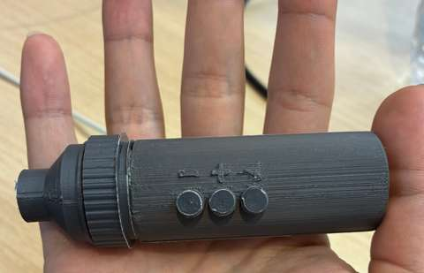
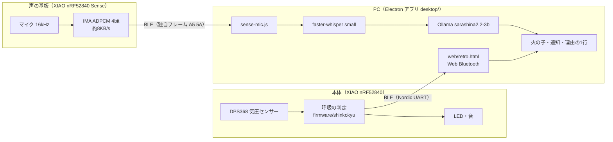
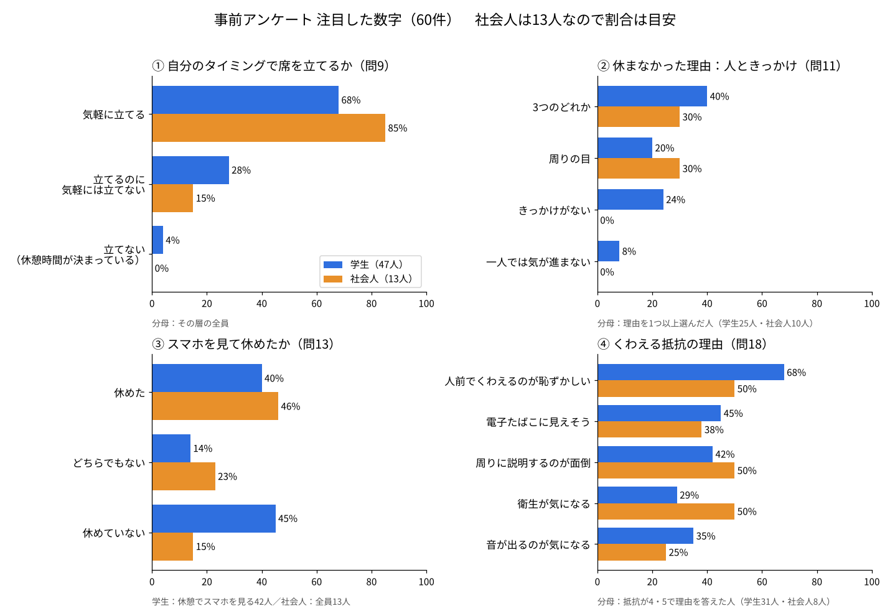

# シン呼吸 — 吸わなくても、気軽にひと息つける

たばこ休憩のように席を立つための **「口実・相手・休み方」** を、たばこを吸わない人にも渡す呼吸デバイスと、デスクトップアプリです。
くわえて吸う・吐くを気圧センサーで判定し、本体の LED と音、PC の画面の隅で育つキャラクター「火の子」で、ゆっくりした呼吸と休憩をうながします。

JPHACKS 2026 にチーム「こんにちは」（3人）で出場した作品を、Award Day に向けてポケットに入る本体に作り直した版です。

## 受賞（JPHACKS 2026）

| 賞 | 内容 |
|---|---|
| **Hack Day Audience Award**（札幌会場） | Hack Day 札幌会場の成果発表で、オーディエンス投票で選ばれた |
| **Award Finalist** | 全国約150チームから、Award Day（2026年11月15日、東京大学）に進んだ17チームの1つ |
| **インフィニオン テクノロジーズ ジャパン株式会社賞** | Award Day で授与されたスポンサー賞 |

Hack Day で提出した版：[jphacks/sp_2605](https://github.com/jphacks/sp_2605)

<p align="center"></p>

## できること

- **吸っている間だけ曲が進む本体**：Infineon の気圧センサー DPS368 と Seeed XIAO nRF52840 で吸う・吐くを判定し、LED の色と音（笛・泡・オルゴール）で呼吸をうながす
- **2人で使えるデスクトップアプリ**（Electron）：本体2台を同時に Bluetooth でつなぎ、画面の右下の「火の子」を一緒に育てる。本体の ▶ 長押しで、相手を休憩に誘える
- **休みどきの「理由の1行」**：続けて作業した時間や、作業のリズムの乱れから、休んでいい理由を出す
- **愚痴を「薪」にする**：声の基板（XIAO nRF52840 Sense）で録った声を、**PC の中だけで**文字にし（faster-whisper）、ローカルの LLM（sarashina2.2-3b / Ollama）で短い言葉にして火にくべる。**声も文字も PC の外に出さない**

## しくみ



| 場所 | 中身 |
|---|---|
| [firmware/](firmware/) | 本体（`shinkokyu/`）と声の基板（`sense_mic/`）の Arduino プログラム、動作確認用のスケッチ |
| [desktop/](desktop/) | Electron アプリ。窓の管理、BLE の声の受信、音声認識と LLM の呼び出し（`voice/`） |
| [web/](web/) | アプリの中で表示する画面。Web Bluetooth で本体とつなぐ `device.js`、ゲームの画面 `retro.html` |
| [songs/](songs/) | 吸っている間に進む曲のデータ |
| [hardware/](hardware/) | KiCad の基板（`carrier/`・`carrier_b/`）、Python で作った外装（`enclosure/`）、3D プリント用の STL（`print/`） |
| [docs/](docs/) | 仕様、課題の整理、人物像、外装・部品表などの設計資料 |

**使った技術**：C++（Arduino / nRF52）、JavaScript（Electron 45、Web Bluetooth、Canvas）、Python（faster-whisper、KiCad の自動生成、manifold3d・trimesh での外装の形づくり）、Ollama、KiCad、3D プリント

## 担当

チーム3人のうち、本体の組み立て、ファームウェア、デスクトップアプリ、声の機能、3D プリント、発表スライドを担当しました。
（本体の形のたたき台とアンケートの作成はチームメンバー）

## 開発で解いた問題（例）

本番の前の数日で、実機で起きた不具合を、ログを取って原因を確かめてから直しました。

| 問題 | 原因 | 直し方 | 結果 |
|---|---|---|---|
| 窓を閉じて開き直したあと、録音しても文字にならない | 同じ本体への BLE 接続が2重にでき、古い接続にもデータが流れていた | 接続をモジュール全体の `Map` で1つに管理し、切断時にリスナーを外す（`web/device.js`） | 実機で解消を確認 |
| 2台つないでいると、録音の停止ボタンが画面に反映されないことがある | BLE が混んでいると、応答なしの書き込み（`REC 0`）が落ちる | 応答ありの書き込み＋2秒のタイムアウト＋3回まで再送の送信キュー。届かなくても、止めた時刻までの声で文字にする（`desktop/sense-mic.js`・`panel.html`） | 実機で解消を確認 |
| 声の基板が途中で止まると、録音が終わらない | 基板側からデータが来ない状態を検知していなかった | 3秒データが来なければ PC のマイクに切りかえる | 模擬テストで確認 |
| 録音を止めてから「薪」になるまで約60秒かかる | 音声認識モデルの読み込みと、LLM の初回ロード | 起動5秒後に先読み（ウォームアップ）、`cpu_threads` の調整、LLM を `keep_alive` で常駐、結果をすぐ通知 | **約60秒 → 約3.4秒** |
| 起動直後、PC から音が出ないことがある | 画面が top-level await のモジュールで、`did-finish-load` の時点ではまだ API がない | API ができるまで最大15秒待ってから呼ぶ `callReady()` を用意 | 実機で解消を確認 |

## 課題の確かめ方（事前アンケート 60件：学生47人・社会人13人）



- 席を**立てるのに気軽には立てない**学生が **28%**
- 休まなかった理由がある学生の **40%** が、「周りの目」「きっかけがない」など**人ときっかけの理由**を選んだ
- 休憩でスマホを見る学生の **45%** が「休めていない」と答えた
- くわえることに抵抗がある学生の **68%** が「人前でくわえるのが恥ずかしい」を選んだ

この結果から、「休む口実」「一緒に休む相手」「スマホを見ない休み方」の3つを柱にしました（[docs/PRODUCT.md](docs/PRODUCT.md)、[docs/PERSONA.md](docs/PERSONA.md)）。

## 動かし方

```bash
cd desktop
npm install
npm start
```

- 本体のプログラムは Arduino IDE で `firmware/shinkokyu/` を Seeed XIAO nRF52840 に書きこむ（詳しくは [firmware/README.md](firmware/README.md)）
- 声の機能には Python（faster-whisper）と Ollama が要る（[desktop/README.md](desktop/README.md)）

## 補足

- 開発では Claude Code（AI のコーディング支援）を使いました。仕様の決定、実機での確認、不具合の切り分けは自分で行っています
- このリポジトリは、面接などで見てもらうために、チームの開発用リポジトリから設計資料とコードを選んでまとめたものです。アンケートの個別の回答や連絡先は入れていません
