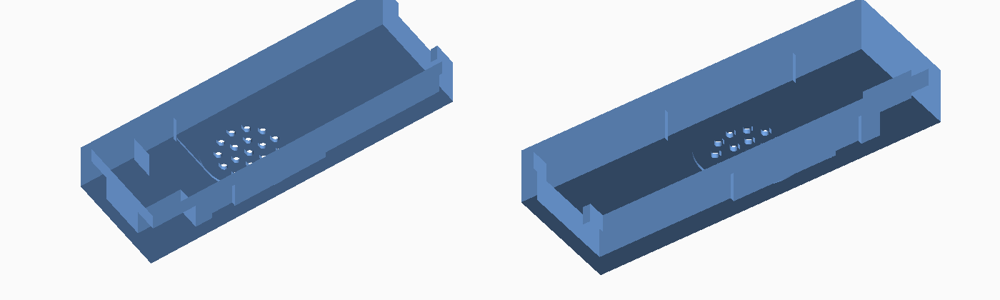
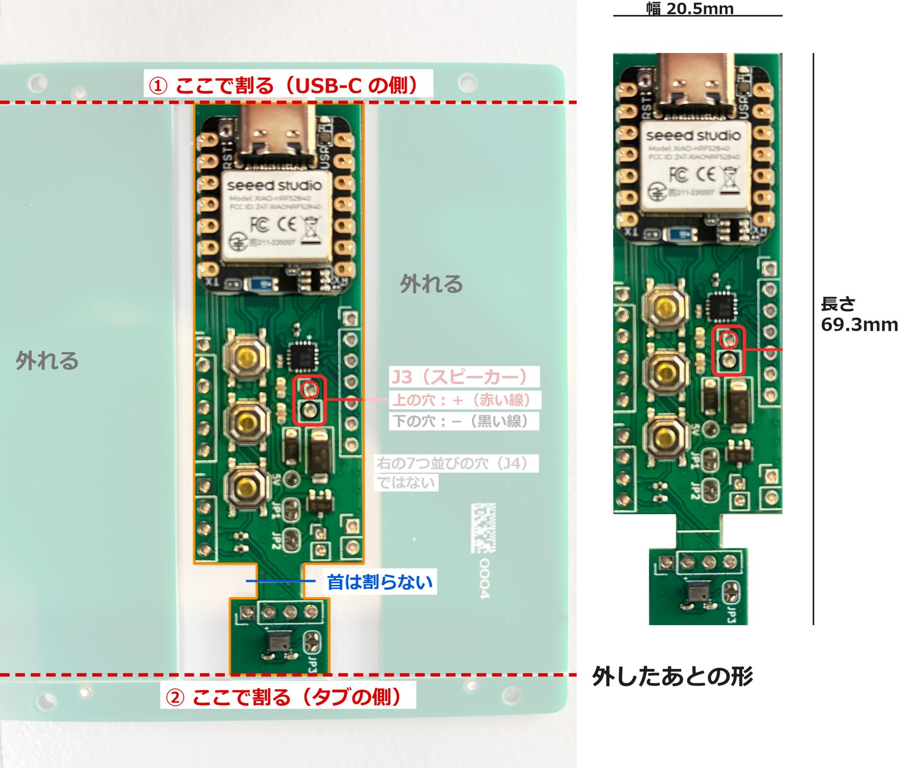

# 本体の筒（3D プリンター用のデータ）

[docs/ENCLOSURE.md](../../docs/ENCLOSURE.md)（oira0822 さんのたたき台、11/03 版）をもとに、形を Python で作る。基板の形と部品の位置は、B版の KiCad のデータ（[hardware/carrier_b/](../carrier_b/)）から取った。

| ファイル | 中身 |
|---|---|
| [stl/board_box.stl](stl/board_box.stl) | **試し刷り**：今の基板（枠から外したもの）とスピーカーが入る、上が開いた箱。73.2 × 24.4 × 11.9 mm |
| [stl/B_lower_shell.stl](stl/B_lower_shell.stl) | 下の殻（B）の1回目。刷る向き（合わせ面が下） |
| [stl/B_lower_shell_model.stl](stl/B_lower_shell_model.stl) | 下の殻を、組み立てたときの向きのまま出したもの（確かめる用） |
| [make_enclosure.py](make_enclosure.py) | 上の STL を作るプログラム。寸法はファイルの最初にまとめてある |



## 試し刷りの箱（board_box.stl）

- 基板は四角い枠に入り、両端の台にのる。すき間はまわりに 0.35mm
- 基板の下（高さ 6.5mm）に、スピーカー（φ20）を下向きに置く。底のくぼみに置き、底の 19 個の穴から音が出る。電池も、あとで XIAO の下に入る
- 後ろの壁に、USB-C の切り欠きがある（箱に入れたまま、書き込みも給電もできる）
- 上は開いていて、ボタンを押せ、気圧センサーに息を吹ける
- 確かめること：基板がゆるすぎず・きつすぎず入るか、スピーカーが入るか、USB のケーブルが差さるか
- 基板は、先に枠から外す。枠とつながっているのは上下の Vカットの線だけ（左右は切り離してある）。カッターで表と裏から線をなぞってから、大きな板を机に押さえて、帯を下（裏の側）に曲げて割る。**首の線（裏の CUT）は割らない**



## 刷り方（Ultimaker S3・PLA）

- 層の高さ 0.2mm、充填 20%、サポートなし（どの部品も、支えなしで刷れる形にしてある）
- 箱は底を下に、下の殻は合わせ面（平らな面）を下に置く

## 作り直し方

OneDrive の外に、専用の Python の場所を作って入れる。

```bash
py -m venv ~/venvs/shinkokyu-cad
~/venvs/shinkokyu-cad/Scripts/python -m pip install manifold3d trimesh numpy
~/venvs/shinkokyu-cad/Scripts/python hardware/enclosure/make_enclosure.py
```

## たたき台から変えたこと・決めたこと

- 下の殻の内側の底は、45° の屋根の形＋平らな橋にした。合わせ面を下にして刷るとき、支えなしで刷れるようにするため。スピーカーの下の空間が少し狭くなるだけで、ほかは変わらない
- 基板の厚さは 0.8mm（注文した厚さ）。溝の高さは 0.9mm（0.1mm のすき間）にした
- マイク用の Sense 版は、メインの XIAO の真上に重ねる（上の殻 A に入る）。XIAO の上は空いていて、ボタンの場所とも重ならず、筒を長くしなくて済む。USB-C が2つ後ろに縦に並ぶので、Sense 版も筒を開けずに書き込める
- Sense 版の電源：電池の線（基板の J2 の VBAT の側）から Sense 版の裏の BAT+ へ、BAT− は GND へつなぐ。2つの XIAO が、それぞれ自分のレギュレーター（SGM2040）で電池から 3.3V を作る。**3V3 の端子どうしはつながない**（レギュレーターの出口どうしがぶつかり、片方だけ USB を差したとき逆向きに電気が入る。これに耐える作りかは確かめられなかった）。先に電池をつなぐ（H07）。作っている間（V02・V04）は、Sense 版を自分の USB で動かし、基板にはつながない
